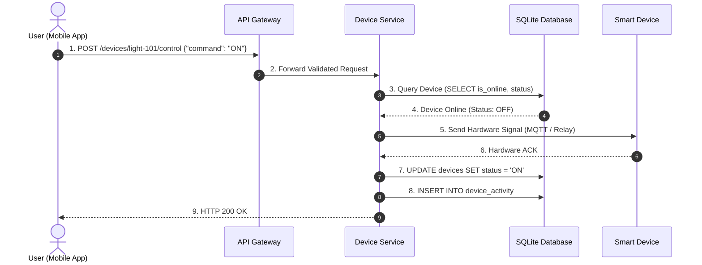

# Smart Home Device Management Platform

A high-performance, beginner-friendly Smart Home Device Management Platform built using **Python FastAPI and SQLite**, designed for college practicals and system design interviews.

---

## 📌 Project Overview
This platform provides REST APIs for:
1. **Register Device**: Add new smart devices with room and initial state.
2. **Get Device Status**: Check real-time power state (`ON`/`OFF`) and connectivity.
3. **Control Device**: Turn devices `ON` or `OFF` with automated activity logging.
4. **Get Device Activity**: Chronological audit trail of commands and status changes.
5. **Remove Device**: Decommission devices and clean up historical records.

---

## 🛠️ Technology Stack
- **Python**: FastAPI, Uvicorn, SQLite, Pydantic
- **Java**:
  - **Standalone Java 21 REST Server** (`java/com/smarthome/SmartHomeServer.java`) using built-in `com.sun.net.httpserver.HttpServer` and Virtual Threads (Zero external dependencies).
  - **Spring Boot 3 Project** (`java/spring-boot/`) with Spring Data JPA, Spring Web, and H2 database.

---

## 🚀 Quick Start Guide

### Option 1: Run with Python (FastAPI + SQLite)
```bash
pip install -r requirements.txt
uvicorn main:app --reload
```
Swagger UI: 👉 **http://127.0.0.1:8000/docs**

---

### Option 2: Run with Java (Zero-Dependency Standalone Server)
Requires only standard Java 21 (no Maven required):
```bash
javac -d bin java/com/smarthome/SmartHomeServer.java
java -cp bin com.smarthome.SmartHomeServer
```
API Root: 👉 **http://127.0.0.1:8080/**

---

### Option 3: Run with Spring Boot
```bash
cd java/spring-boot
mvn spring-boot:run
```
Swagger UI: 👉 **http://localhost:8080/docs**
H2 Console: 👉 **http://localhost:8080/h2-console**

---

## 📡 REST API Reference

| Method | Endpoint | Description | Status Code |
| :--- | :--- | :--- | :--- |
| `POST` | `/devices` | Register a new smart device | `201 Created` |
| `GET` | `/devices/{device_id}/status` | Get device current status | `200 OK` |
| `POST` | `/devices/{device_id}/control` | Control device (turn ON/OFF) | `200 OK` |
| `GET` | `/devices/{device_id}/activity` | Get device activity history | `200 OK` |
| `DELETE` | `/devices/{device_id}` | Remove a device | `200 OK` |
| `GET` | `/devices` | List all registered devices | `200 OK` |

### Sample Control Request (`POST /devices/light-101/control`):
```json
{
  "command": "ON",
  "performed_by": "Mobile App User"
}
```

### Sample Control Response:
```json
{
  "message": "Device light-101 successfully turned ON.",
  "device_id": "light-101",
  "previous_status": "OFF",
  "current_status": "ON",
  "timestamp": "2026-10-12T15:21:45.987654"
}
```

---

## 📐 System Architecture & Diagrams

### 1. Sequence Diagram: Device Control Flow
```
User -> Select Device -> Send Command -> Device Service -> Smart Device -> Status Update
```



### 2. High-Level System Architecture (Supporting Millions of Devices)
- **Clients**: Mobile Apps & Web Dashboard.
- **Edge Layer**: Load Balancers (ALB/NGINX) & API Gateway (Rate limiting, JWT Auth).
- **Microservices**: Device Registry, Device Control, Device Monitoring, Notification Service.
- **Caching**: Redis Cluster for device status caching (`device:{id}:status`) and heartbeat presence (TTL).
- **Messaging**: MQTT Broker (EMQX/HiveMQ) for lightweight IoT protocol + Apache Kafka for asynchronous event queues.
- **Databases**:
  - PostgreSQL for relational data (Users, Homes, Permissions).
  - MongoDB for dynamic device configuration schemas.
  - TimescaleDB / Cassandra for high-throughput activity logs & telemetry.
